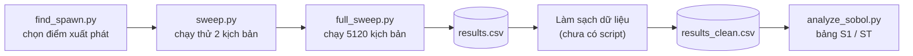

# Kiểm thử xe tự hành trên CARLA bằng phân tích độ nhạy Sobol

Tài liệu cho người tiếp nhận dự án. Không cần đọc từng dòng code: mỗi file `.py` có một đoạn ghi chú ở đầu file nói nó làm gì, còn tài liệu này nối các file lại với nhau và chỉ chỗ cần sửa khi có yêu cầu mới.

Mục lục

1. [Dự án làm gì](#1-dự-án-làm-gì)
2. [Quy trình chạy từ đầu đến cuối](#2-quy-trình-chạy-từ-đầu-đến-cuối)
3. [Từng file làm gì](#3-từng-file-làm-gì)
4. [Cài đặt và chạy](#4-cài-đặt-và-chạy)
5. [Khi thầy yêu cầu sửa](#5-khi-thầy-yêu-cầu-sửa)
6. [Câu hỏi thầy có thể hỏi](#6-câu-hỏi-thầy-có-thể-hỏi)
7. [Điểm yếu đã biết](#7-điểm-yếu-đã-biết)
8. [Thuật ngữ](#8-thuật-ngữ)

---

## 1. Dự án làm gì

Trên trình mô phỏng CARLA, hai xe chạy cùng làn trên một đoạn đường thẳng:

- **ego** (Tesla Model 3) là xe được kiểm thử, chạy phía sau.
- **target** (Audi A2) là xe chạy phía trước.

Mỗi xe cố giữ tốc độ của mình. Ego có một luật phanh đơn giản: nếu khoảng cách tới target nhỏ hơn "khoảng cách an toàn" thì phanh. Mỗi lần chạy kéo dài 12,5 giây mô phỏng (250 bước × 0,05 giây), rồi ghi lại các con số đo mức nguy hiểm.

Câu hỏi nghiên cứu: trong 4 yếu tố dưới đây, yếu tố nào quyết định mức nguy hiểm nhiều nhất?

| Tham số | Ý nghĩa | Khoảng thử |
|---|---|---|
| `ego_speed` | tốc độ ego muốn giữ | 40–100 km/h |
| `target_speed` | tốc độ của target | 20–70 km/h |
| `initial_distance` | khoảng cách ban đầu giữa 2 xe | 15–60 m |
| `friction` | ma sát mặt đường (thấp = trơn) | 0,3–1,0 |

Để trả lời, dự án chạy 5120 kịch bản với các tổ hợp giá trị khác nhau, rồi dùng phương pháp Sobol (thư viện SALib) để tính mỗi yếu tố gây ra bao nhiêu phần mức dao động của kết quả.

Mỗi lần chạy đo 4 kết quả:

| Kết quả | Ý nghĩa | Đơn vị | Nguy hiểm khi |
|---|---|---|---|
| `min_distance` | khoảng cách nhỏ nhất giữa tâm 2 xe | m | nhỏ |
| `min_acceleration` | gia tốc dọc nhỏ nhất của ego (âm = đang giảm tốc) | m/s² | rất âm (phanh gắt) |
| `min_jerk` | độ giật nhỏ nhất, tức gia tốc thay đổi nhanh cỡ nào | m/s³ | rất âm (phanh đột ngột) |
| `min_ttc` | thời gian tới va chạm nhỏ nhất, nếu 2 xe giữ nguyên tốc độ | s | nhỏ |

Khi phân tích, `min_ttc` được thay bằng `inv_ttc = 1 / min_ttc` (lý do ở [mục 6](#tại-sao-phân-tích-inv_ttc-mà-không-phải-min_ttc)).

---

## 2. Quy trình chạy từ đầu đến cuối



Mọi file đều đọc thông số từ `config.py`. Muốn đổi thông số nào, gần như luôn sửa ở `config.py`, không sửa trong các file khác.

`find_spawn.py` chỉ cần chạy lại khi đổi bản đồ. `script.py` là bản demo để nhìn bằng mắt, không nằm trong quy trình.

---

## 3. Từng file làm gì

| File | Làm gì | Cần CARLA đang chạy? |
|---|---|---|
| [config.py](config.py) | Bảng thông số của toàn bộ dự án. Không chạy, chỉ sửa. | không |
| [sweep.py](sweep.py) | Chứa hàm `run_scenario`: chạy **một** kịch bản và trả về 4 kết quả. Chạy trực tiếp thì thử các kịch bản trong `TEST_CASES`. | có |
| [full_sweep.py](full_sweep.py) | Sinh bộ mẫu Sobol, gọi `run_scenario` cho từng mẫu, ghi `results.csv`. Đây là bước chạy lâu nhất. | có |
| [analyze_sobol.py](analyze_sobol.py) | Đọc `results_clean.csv`, in bảng chỉ số Sobol cho từng kết quả. | không |
| [check_sobol_sample.py](check_sobol_sample.py) | Xem trước bộ mẫu: bao nhiêu dòng, vài dòng đầu trông ra sao. | không |
| [find_spawn.py](find_spawn.py) | In ra các điểm xuất phát nằm trên đoạn thẳng đủ dài của bản đồ đang mở. | có |
| [script.py](script.py) | Demo 1 kịch bản ngắn, camera bám theo ego. Không có luật phanh, không ghi file. | có |

### sweep.py: một kịch bản diễn ra thế nào

1. Dọn xe và vùng ma sát còn sót lại từ lần chạy trước.
2. Bật chế độ đồng bộ (synchronous mode): mỗi bước mô phỏng trôi đúng 0,05 giây, không phụ thuộc máy nhanh hay chậm.
3. Đặt ego ở điểm xuất phát số 117 của bản đồ.
4. Đặt target phía trước ego đúng `initial_distance` mét, cùng làn.
5. Gán ngay cho mỗi xe vận tốc bằng tốc độ mục tiêu, để không phải tăng tốc từ 0.
6. Đặt một vùng ma sát hình hộp, tâm tại vị trí ego, với hệ số `friction`.
7. Chạy 250 bước. Ở mỗi bước, ego tính khoảng cách an toàn = tốc độ × 2 giây + 5 m. Nếu gần hơn mức đó thì phanh 80%, nếu xa hơn thì giữ tốc độ. Target luôn giữ tốc độ. Mỗi bước ghi lại khoảng cách, gia tốc, jerk và TTC.
8. Lấy giá trị nhỏ nhất của từng đại lượng. Riêng gia tốc và jerk bỏ 10 bước đầu (0,5 giây) vì vật lý xe chưa ổn định ngay sau khi đặt xe.
9. Xóa xe, xóa vùng ma sát, tắt chế độ đồng bộ. Bước này luôn chạy, kể cả khi có lỗi.

Ví dụ: ego chạy 60 km/h (16,7 m/s) thì khoảng cách an toàn là 16,7 × 2 + 5 ≈ 38 m. Nếu target xuất phát cách 20 m, ego phanh ngay từ bước đầu tiên.

### full_sweep.py: chạy toàn bộ thí nghiệm

- Mỗi lần chạy xong ghi ngay 1 dòng vào `results.csv`, nên dừng giữa chừng vẫn giữ được phần đã chạy.
- Lần chạy nào lỗi vẫn có dòng riêng: các cột kết quả để trống, cột `error` ghi lý do. Việc giữ dòng lỗi là cố ý, vì phân tích Sobol cần đủ số dòng và đúng thứ tự.
- **Mỗi lần bắt đầu, `results.csv` bị ghi đè.** Sao chép file cũ ra chỗ khác trước khi chạy lại.
- Cuối cùng script in tổng thời gian và thời gian trung bình mỗi lần chạy. Ghi lại con số này để ước lượng khi thầy yêu cầu tăng số mẫu.

### analyze_sobol.py: đọc bảng kết quả

Với mỗi kết quả đo, script in một bảng 4 dòng (4 tham số), sắp theo cột ST giảm dần:

| Cột | Nghĩa |
|---|---|
| `S1` | Ảnh hưởng **riêng** của tham số, từ 0 đến 1. S1 = 0,6 nghĩa là riêng tham số này giải thích khoảng 60% mức dao động của kết quả. |
| `ST` | Ảnh hưởng **tổng**, gồm cả phần tác động chung với các tham số khác. |
| `ST-S1` | Phần ảnh hưởng đến từ tương tác với tham số khác. |

Cách đọc:

- Dòng trên cùng là tham số quan trọng nhất với kết quả đó.
- ST gần 0: tham số gần như không ảnh hưởng, nghiên cứu sau có thể cố định nó.
- ST − S1 lớn: tham số chỉ quan trọng khi đi cùng tham số khác. Ví dụ, nếu `friction` có S1 = 0,05 nhưng ST = 0,25, thì ma sát một mình ít tác động, nhưng khi kết hợp với tốc độ cao thì đáng kể.
- Tổng S1 của 4 tham số không vượt quá 1. Phần còn thiếu để đủ 1 là phần do tương tác.
- Giá trị hơi âm (ví dụ −0,01), hoặc S1 lớn hơn ST một chút, là sai số do lấy mẫu, coi như 0. Tăng `SOBOL_N` sẽ giảm sai số này.

---

## 4. Cài đặt và chạy

Cần có:

- CARLA server (mở `CarlaUE4.exe`, đợi bản đồ tải xong). Code dùng bản đồ đang mở, không tự đổi bản đồ.
- Python có gói `carla` **cùng phiên bản với CARLA server** (ví dụ server 0.9.15 thì `pip install carla==0.9.15`).
- `pip install SALib pandas`

Bản đồ đã dùng khi chọn `SPAWN_INDEX = 117`: **(cần điền, ví dụ Town10HD)**

Thứ tự chạy, mở terminal trong thư mục dự án:

```
python sweep.py                 # chạy thử 2 kịch bản, xem CARLA và code có hoạt động không
python check_sobol_sample.py    # (tùy chọn) xem sẽ phải chạy bao nhiêu lần
python full_sweep.py            # chạy toàn bộ, ra results.csv. Rất lâu.
#   -> làm sạch results.csv thành results_clean.csv (xem mục 7)
python analyze_sobol.py         # in bảng chỉ số Sobol
```

Khi muốn xem bằng mắt: `python script.py`, rồi nhìn vào cửa sổ CARLA.

---

## 5. Khi thầy yêu cầu sửa

### Những thay đổi chỉ cần sửa config.py

| Yêu cầu | Sửa trong config.py | Ghi chú |
|---|---|---|
| Đổi khoảng giá trị của một tham số | `PROBLEM` → `bounds` | Thứ tự các dòng bounds khớp với thứ tự `names`. |
| Tăng/giảm số mẫu | `SOBOL_N` | Dùng lũy thừa của 2: 256, 512, 1024, 2048. Thời gian chạy tăng tỉ lệ thuận. |
| Mô phỏng lâu hơn | `TICKS` | Thời gian mô phỏng = `TICKS × DT`. |
| Bước thời gian nhỏ hơn (chính xác hơn) | `DT` | Chạy chậm hơn. Muốn giữ nguyên thời gian mô phỏng thì tăng `TICKS` tương ứng. Jerk tự dùng `DT` mới. |
| Đổi luật phanh | `SAFE_GAP_TIME`, `SAFE_GAP_MIN`, `EMERGENCY_BRAKE` | Khoảng cách an toàn = tốc độ × `SAFE_GAP_TIME` + `SAFE_GAP_MIN`. `EMERGENCY_BRAKE` từ 0 đến 1. |
| Ego bám tốc độ nhanh/chậm hơn | `SPEED_K` | Lớn hơn → đạp ga/phanh mạnh hơn khi lệch tốc độ. |
| Đổi loại xe | `EGO_BLUEPRINT`, `TARGET_BLUEPRINT` | Tên xe theo danh sách blueprint của CARLA, ví dụ `vehicle.lincoln.mkz_2020`. |
| Đổi vị trí xuất phát | `SPAWN_INDEX` | Chạy `find_spawn.py` để lấy danh sách số hợp lệ. |
| Đổi bản đồ | (mở bản đồ khác trong CARLA) + `SPAWN_INDEX` | Bắt buộc chạy lại `find_spawn.py`, vì số 117 trên bản đồ khác là chỗ khác. |
| Đoạn thẳng phải dài hơn | `STRAIGHT_LENGTH` | Rồi chạy lại `find_spawn.py`. |
| Muốn bộ mẫu lặp lại y hệt | `SOBOL_SEED` | Đặt một số nguyên bất kỳ, ví dụ 42. |
| Bỏ bớt / thêm 10 bước đầu khi tính gia tốc, jerk | `SETTLE_TICKS` | |
| Đổi tên file kết quả | `RESULTS_CSV`, `RESULTS_CLEAN_CSV` | |
| Chỉ phân tích một số kết quả | `ANALYZE_OUTPUTS` | Chỉ cần chạy lại `analyze_sobol.py`. |

Phải chạy lại bước nào:

- Đổi bất cứ thứ gì ảnh hưởng tới mô phỏng (mọi mục trong bảng trên trừ 2 dòng cuối): chạy lại `full_sweep.py` → làm sạch → `analyze_sobol.py`. Sao lưu `results.csv` cũ trước.
- Chỉ đổi phần phân tích (`ANALYZE_OUTPUTS`, `RESULTS_CLEAN_CSV`): chỉ chạy lại `analyze_sobol.py`.
- Nên chạy `python sweep.py` trước `full_sweep.py` mỗi khi đổi gì đó, để bắt lỗi trong vài giây thay vì sau vài giờ.

### Những thay đổi phải sửa code

Các việc dưới đây không làm được chỉ bằng config. Có thể nhờ người biết Python hoặc một trợ lý AI sửa, và đưa cho họ đúng các vị trí này.

**Thêm một tham số đầu vào** (ví dụ độ dốc, thời tiết):

1. `config.py`: trong `PROBLEM`, tăng `num_vars`, thêm tên vào `names`, thêm khoảng vào `bounds`. Thêm tên vào `CSV_FIELDS`.
2. `sweep.py`: thêm tham số vào hàm `run_scenario` và dùng nó trong mô phỏng.
3. `full_sweep.py`: dòng `ego_s, tgt_s, dist, fric = row` thêm một biến, truyền vào `run_scenario`, và thêm vào `record` ở cả hai nhánh (thành công và lỗi).
4. Số lần chạy tăng theo công thức N × (2D + 2): với 5 tham số là N × 12.

**Thêm một kết quả đo** (ví dụ có va chạm hay không, quãng đường phanh):

1. `sweep.py`: tính trong vòng lặp `for i in range(cfg.TICKS)` và thêm vào dict ở dòng `return`.
2. `full_sweep.py`: thêm vào `record` (nhánh lỗi để `''`).
3. `config.py`: thêm tên vào `CSV_FIELDS`, và vào `ANALYZE_OUTPUTS` nếu muốn phân tích Sobol.

**Thay luật phanh bằng thuật toán khác** (ACC, PID, phanh theo TTC): sửa đoạn `if d_now < safe_gap: ... else: ...` trong vòng lặp của `run_scenario` ở `sweep.py`.

**Phát hiện va chạm thật**: gắn cảm biến `sensor.other.collision` vào ego trong `run_scenario`, đếm số lần va chạm, trả về như một kết quả đo mới.

---

## 6. Câu hỏi thầy có thể hỏi

### Tại sao dùng Sobol mà không thay từng tham số một?

Thay từng tham số một (giữ các tham số khác cố định) chỉ cho biết ảnh hưởng quanh một điểm và không thấy được tương tác. Ví dụ ma sát thấp có thể chỉ nguy hiểm khi ego chạy nhanh và xuất phát gần. Nếu thử riêng ma sát ở tốc độ thấp thì sẽ thấy nó vô hại. Sobol rải mẫu khắp không gian 4 tham số và tách được phần ảnh hưởng riêng (S1) với phần do tương tác (ST − S1).

### Tại sao 5120 lần chạy? N = 512 lấy từ đâu?

SALib sinh N × (2D + 2) mẫu khi tính cả chỉ số bậc 2 (mặc định của SALib). Với D = 4 tham số: 512 × 10 = 5120. N nên là lũy thừa của 2 vì dãy Sobol phân bố đều nhất tại các mốc đó, và SALib cảnh báo nếu không phải. N lớn hơn thì chỉ số chính xác hơn nhưng thời gian chạy tăng tỉ lệ thuận. Nếu bị hỏi 512 đã đủ chưa, cách trả lời có số liệu là in khoảng tin cậy (xem [mục 7](#7-điểm-yếu-đã-biết)) hoặc chạy thêm N = 1024 để so sánh.

### S1 và ST khác nhau thế nào?

S1 là phần dao động của kết quả do riêng tham số đó gây ra. ST là tổng phần nó góp vào, cộng cả khi tác động chung với tham số khác. ST − S1 lớn nghĩa là tham số đó có tương tác mạnh. Nếu S1 ≈ ST với mọi tham số thì các tham số tác động gần như độc lập.

### Tại sao bỏ 10 bước đầu khi tính gia tốc và jerk?

Ngay sau khi đặt xe vào bản đồ và gán vận tốc đột ngột, bánh xe và thân xe chưa đồng bộ, CARLA báo ra những gia tốc rất lớn không có thật. Nếu giữ lại, `min_acceleration` và `min_jerk` sẽ phản ánh lỗi khởi tạo chứ không phải cú phanh. 10 bước = 0,5 giây.

### Tại sao phân tích inv_ttc mà không phải min_ttc?

`min_ttc` bị trống khi ego không bao giờ lại gần target (ví dụ ego 40 km/h, target 70 km/h), và có thể rất lớn khi tốc độ tiếp cận chỉ hơn 0,1 m/s một chút. Sobol dựa trên phương sai, nên vài giá trị khổng lồ sẽ chi phối toàn bộ kết quả. Đổi sang 1/TTC thì 0 nghĩa là không có nguy cơ, số càng lớn càng nguy hiểm, và không còn ô trống.

### Tại sao dùng synchronous mode, DT = 0,05 giây?

Ở chế độ thường, CARLA chạy theo thời gian thực, máy chậm thì mỗi bước dài hơn và kết quả thay đổi theo máy. Chế độ đồng bộ bắt mỗi bước trôi đúng `DT` giây, nên kết quả lặp lại được và không phụ thuộc phần cứng. 0,05 giây (20 bước mỗi giây) là mức cân bằng giữa độ chính xác và tốc độ chạy. Muốn chính xác hơn thì giảm `DT`.

### Tại sao gán vận tốc ban đầu cho xe?

Nếu để xe tăng tốc từ 0, mấy giây đầu tốc độ thực tế khác với giá trị trong mẫu, và khoảng cách ban đầu cũng thay đổi trong lúc tăng tốc. Gán vận tốc ngay từ đầu để kịch bản bắt đầu đúng với bộ tham số được chọn.

### Khoảng cách đo thế nào? Bao nhiêu thì là đâm?

Khoảng cách là giữa **tâm** 2 xe, không phải từ đầu xe sau tới đuôi xe trước. Hai xe chạm nhau khi khoảng cách tâm xấp xỉ bằng nửa chiều dài xe ego cộng nửa chiều dài xe target, khoảng 4–4,5 m với hai mẫu xe này. Muốn con số chính xác thì đọc `bounding_box.extent.x` của từng xe trong CARLA (đó là nửa chiều dài) rồi cộng lại.

### Luật phanh lấy ở đâu ra?

Khoảng cách an toàn = tốc độ × 2 giây + 5 m, giống quy tắc "giữ khoảng cách 2 giây" khi lái xe, cộng thêm 5 m dự phòng (một phần để bù việc đo từ tâm xe). Lực phanh cố định 0,8. Đây là luật đơn giản đặt ra để có một hệ thống cần kiểm thử, không phải thuật toán của xe tự hành thật. Đổi các con số này ở `config.py` (mục 5).

### Ma sát 0,3–1,0 nghĩa là gì?

Đó là hệ số ma sát lốp mà vùng `static.trigger.friction` của CARLA áp cho bánh xe khi xe đi vào vùng. Hệ số thấp thì bánh dễ trượt khi phanh, quãng phanh dài hơn. Để biết 1,0 tương ứng mặt đường bình thường hay trơn hơn, cần so với hệ số ma sát lốp mặc định của xe trong CARLA (`vehicle.get_physics_control().wheels[0].tire_friction`). Việc so sánh này chưa làm.

### Kết quả có lặp lại được không?

Chế độ đồng bộ với `DT` cố định cho kết quả gần như lặp lại, nhưng CARLA không cam kết vật lý tất định tuyệt đối. Về bộ mẫu: tùy phiên bản SALib, nếu `SOBOL_SEED = None` thì mỗi lần chạy có thể ra bộ mẫu khác. Đặt `SOBOL_SEED` là một số nguyên để cố định.

### Lần chạy bị lỗi thì sao?

Lần đó vẫn có một dòng trong `results.csv` với cột `error` ghi lý do. Không được xóa dòng đó trước khi phân tích, vì Sobol dựa vào vị trí từng dòng. Cách xử lý: chạy lại riêng các bộ tham số bị lỗi bằng `run_scenario` rồi điền kết quả vào đúng dòng đó.

---

## 7. Điểm yếu đã biết

Nên biết trước những điểm này để không bị bất ngờ khi thầy hỏi, và để ưu tiên sửa nếu có thời gian.

1. **Bước làm sạch `results.csv` → `results_clean.csv` không có script trong repo.** Bước này đã được làm riêng bên ngoài. Yêu cầu tối thiểu với file sạch: đủ số dòng, giữ nguyên thứ tự, không có ô trống ở các cột được phân tích, có cột `inv_ttc` (= 1 / `min_ttc`, bằng 0 khi `min_ttc` trống).
2. **Không có cảm biến va chạm.** Có đâm hay không chỉ suy ra được từ `min_distance` (xem câu hỏi về khoảng cách ở mục 6).
3. **Xe không đánh lái** (luôn đi thẳng), trong khi `find_spawn.py` chỉ xác nhận đoạn thẳng dài khoảng 110–120 m (vòng kiểm tra dừng ở 110 m). Trong 12,5 giây, target chạy 70 km/h đi được khoảng 240 m. Cần mở `script.py` hoặc nhìn trong CARLA để kiểm tra xe có đi ra khỏi đoạn thẳng ở các kịch bản tốc độ cao không.
4. **Kích thước vùng ma sát chưa kiểm chứng.** `FRICTION_EXTENT = 20000`. Theo tài liệu CARLA, extent tính bằng cm và là nửa kích thước tính từ tâm, tức vùng trải khoảng 200 m về mỗi phía từ chỗ ego xuất phát. Ghi chú cũ trong code lại ghi "200m x 200m". Cần kiểm tra lại, vì nếu vùng nhỏ hơn quãng đường xe đi thì cuối mỗi lần chạy xe đã ra khỏi vùng ma sát.
5. **`SPAWN_INDEX` phụ thuộc bản đồ**, và code không tự mở bản đồ. Phải ghi rõ bản đồ đã dùng (mục 4).
6. **Bỏ 10 bước đầu có thể bỏ sót cú phanh thật.** Với nhiều tổ hợp (ego nhanh, xuất phát gần), ego nằm trong vùng an toàn ngay từ đầu và phanh từ bước 1. Cú giật mạnh nhất khi đó rơi vào 0,5 giây đầu đang bị bỏ qua.
7. **`analyze_sobol.py` không in khoảng tin cậy.** SALib đã tính sẵn `S1_conf` và `ST_conf`; chỉ cần in thêm. Thầy có thể hỏi "chỉ số này tin được bao nhiêu".
8. **Ego chưa bao giờ "đuổi kịp" trong một số kịch bản.** Khi `ego_speed` nhỏ hơn `target_speed`, khoảng cách chỉ tăng, kịch bản không có tình huống nguy hiểm. Các dòng này vẫn hợp lệ cho Sobol nhưng nên biết khi diễn giải kết quả.

---

## 8. Thuật ngữ

| Thuật ngữ | Nghĩa |
|---|---|
| ego | Xe được kiểm thử (xe "của mình"). |
| target | Xe phía trước mà ego bám theo. |
| tick | Một bước mô phỏng, dài `DT` giây. |
| spawn / spawn point | Đặt xe vào bản đồ / các vị trí đặt xe có sẵn của bản đồ, đánh số từ 0. |
| blueprint | Mẫu đối tượng trong CARLA, ví dụ `vehicle.tesla.model3`. |
| actor | Mọi đối tượng đang có trong mô phỏng: xe, cảm biến, vùng ma sát. |
| waypoint | Điểm trên làn đường, dùng để tìm vị trí phía trước cùng làn. |
| synchronous mode | Chế độ mô phỏng chỉ tiến lên khi code gọi `tick`, mỗi lần đúng `DT` giây. |
| friction trigger | Vùng hình hộp trong CARLA, xe đi vào sẽ bị đổi hệ số ma sát lốp. |
| TTC | Time-to-collision: còn bao nhiêu giây nữa thì đâm nếu 2 xe giữ nguyên tốc độ. |
| jerk | Tốc độ thay đổi của gia tốc. Jerk lớn = phanh/ga giật cục. |
| Sobol, S1, ST | Phương pháp phân tích độ nhạy dựa trên phương sai; S1 là ảnh hưởng riêng, ST là ảnh hưởng tổng. |
| SALib | Thư viện Python dùng để sinh mẫu và tính chỉ số Sobol. |
